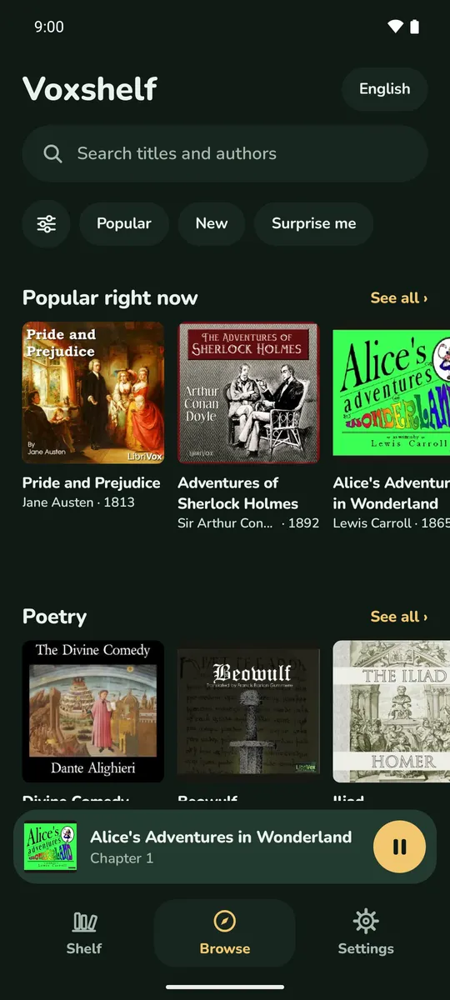
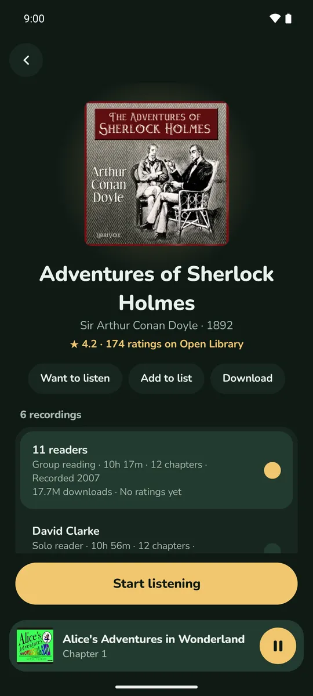
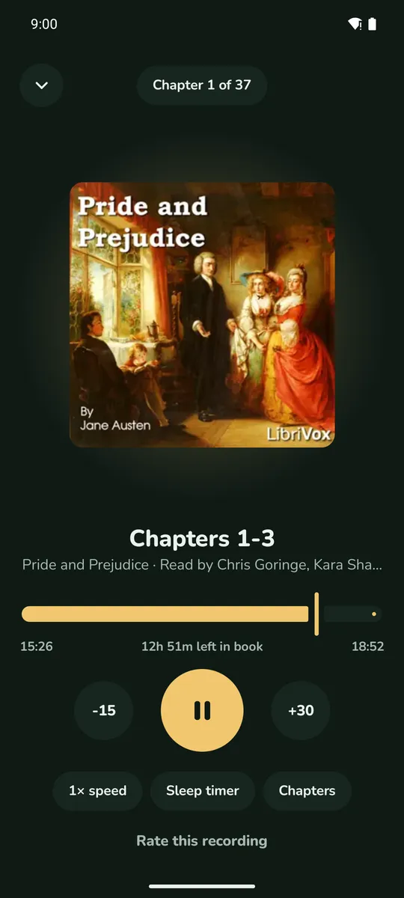

# Voxshelf

**Every classic, read aloud.** Voxshelf is a free, open source Android app for listening to the 20,000+ public domain audiobooks recorded by [LibriVox](https://librivox.org) volunteers. No ads, no tracking, no account.

<p>
  
  
  
</p>

Website: [voxshelf.app](https://voxshelf.app)

## What it does

- **Browse and search** the whole LibriVox catalog, offline: rows by subject, Popular, New, Surprise me, and filters for length, reader type and era.
- **Pick the best recording.** Many books have several readings; Voxshelf ranks them by how much they're listened to and shows listener ratings and Open Library star ratings.
- **Listen anywhere:** background playback with lock screen and Bluetooth controls, downloads for offline listening (with a Wi-Fi-only option), playback speed, a sleep timer, and smart rewind after a long pause.
- **Your shelf:** Listening, Want to listen, Finished and your own lists, with progress and time left for each book.

Voxshelf is an independent app and isn't made or endorsed by LibriVox. If you enjoy the books, please consider [volunteering or donating to LibriVox](https://librivox.org/pages/how-to-help/).

## How it's built

| Folder | What's in it |
| --- | --- |
| `app/` | The Android app: Kotlin, Jetpack Compose and Media3 (ExoPlayer). |
| `catalog/` | Python scripts that build the catalog the app ships with: LibriVox catalog, Internet Archive download counts, Open Library ratings and small cover images. |
| `server/` | A small Cloudflare Worker with a D1 database: recording ratings, problem reports, crash reports and cover images. |
| `site/` | The [voxshelf.app](https://voxshelf.app) website: plain HTML and CSS. |
| `.github/workflows/catalog.yml` | The nightly job that rebuilds the catalog and publishes it to the `catalog` release. |

### Building the app

You need JDK 21 and the Android SDK (compile SDK 37). Then:

```sh
./gradlew assembleDebug
```

The app expects a catalog at `app/src/main/assets/catalog.db`. Download the latest one from the [`catalog` release](../../releases/tag/catalog) (`catalog.db.gz`, then unzip it), or build it yourself with the scripts in `catalog/` (see the nightly workflow for the exact steps).

Debug builds talk to the live ratings server at `api.voxshelf.app`. To run your own, see `server/`: `npx wrangler dev` runs it locally.

### Building the catalog

Python 3.12, plus Pillow for covers. Roughly:

```sh
cd catalog
python fetch_catalog.py raw                 # LibriVox catalog (slow and gentle on purpose)
python fetch_popularity.py popularity.json  # Internet Archive download counts
python build_catalog.py raw catalog.db 20261023 popularity.json openlibrary.json
```

## Privacy

Voxshelf collects almost nothing: anonymous recording ratings, optional problem reports, and crash reports without personal details. The full policy is in [PRIVACY.md](PRIVACY.md) and at [voxshelf.app/privacy](https://voxshelf.app/privacy.html).

## Contributing

Bug reports and ideas are welcome as [issues](../../issues). For bigger changes, please open an issue first so we can talk it through. Questions: hello@voxshelf.app.

## Credits

- Recordings by [LibriVox](https://librivox.org) volunteers, in the public domain in the USA.
- Audio and cover art hosted by the [Internet Archive](https://archive.org).
- Book ratings from [Open Library](https://openlibrary.org).
- Font: [Nunito](https://fonts.google.com/specimen/Nunito), SIL Open Font License (see [licenses/Nunito-OFL.txt](licenses/Nunito-OFL.txt)).

## License

GPL-3.0. See [LICENSE](LICENSE).
